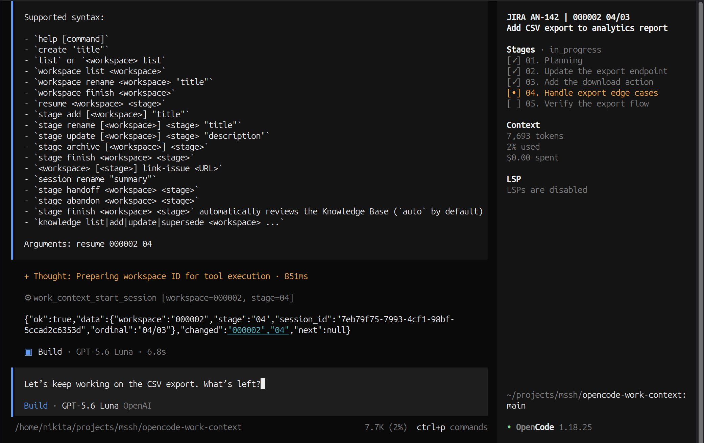

# OpenCode Work Context

Keep the context of a task between OpenCode sessions.

Create one workspace for one task, split it into stages, and return to the
exact stage where you stopped. The optional sidebar and modal show the current
task and its progress at a glance.



> Example: one workspace for one task, linked to Jira issue `AN-142`, with
> three completed stages and the current work highlighted at stage 04.
>
> The sidebar is an optional read-only TUI panel. The core workflow works
> through `/wc` commands and OpenCode tools without it.

Work-context session titles put the stage title first so OpenCode's session
picker remains easy to scan. The second line carries the workspace and stage
IDs, session ordinal, optional issue reference, and inactive state. In the
optional sidebar, the workspace title is shown separately above the stages
panel.

## How It Works

```text
Workspace: Add CSV export to analytics report
├── ✓ 01. Planning
├── ✓ 02. Update the export endpoint
├── ✓ 03. Add the download action
├── • 04. Handle export edge cases   <- current stage
└──   05. Verify the export flow
```

- **Workspace** is one concrete task, such as adding CSV export.
- **Stage** is one step in that task.
- **Planning** is normally the first stage and remains a continuously available coordination surface. Working stages must never depend on it; add dependencies only between working stages with a genuine ordering requirement.
- **Resume** starts a new session at a selected stage.
- **Handoff** preserves the context when moving work to another session.

## Quick Start

Run this from the root of a standalone OpenCode project:

```sh
npx opencode-work-context init
```

Then create a task and its first stage in OpenCode:

```text
/wc create "Add CSV export to analytics report"
/wc stage rename 000001 01 "Planning"
/wc stage add 000001 "Update the export endpoint" "Inspect the current endpoint, implement CSV export, add regression tests, and verify the result."
/wc stage profiles 000001 02 execution implementation depth standard
/wc resume 000001 02
```

`stage add` creates a stage and, when run from a new OpenCode session that is
not associated with a workspace, immediately enters the new stage in that
session. From an already associated session it only creates a `planned` stage;
use `/wc resume <workspace> <stage>` in a separate OpenCode session to enter it.
Multiple sessions may work on the same non-terminal stage through explicit
resume and handoff operations.

Stages remain in progress until the user explicitly requests `/wc stage finish`.
Do not infer that request from completed work. Automatic completion is allowed
only when the workspace Planning-stage prompt includes this standalone line:

```text
AUTO_STAGE_FINISH: allowed
```

### Acknowledge A Manual Commit

When you commit shared in-progress work while an active stage is running, tell
the agent about the exact commit using the short hash printed by Git:

```text
/commited f86f75a
```

`commited` is intentionally spelled with one `t`. It is a compact, explicit
acknowledgement rather than an ownership claim: Work Context requires that hash
to resolve to the current `HEAD`, verifies the session's original attached
branch and fast-forward checkpoint, and rejects rebases, branch changes,
detached `HEAD`, and active Git operations. The checkpoint is per active
session in ignored `.work-context/local/` state; no canonical workspace data,
candidate state, file, hunk, or stage ownership is changed.

The generated command asks OpenCode to execute this deterministic structured
tool as a light control-plane operation. OpenCode does not expose a package API
that selects a model for individual slash commands, so the package does not
claim to force a particular local light-tier mapping.

To correct a completed stage without discarding its result or session history,
use `/wc stage reopen <workspace> <stage> "reason"`. Reopening leaves
downstream stages unchanged and requires a separate-session explicit resume.

To recover an archived stage, use `/wc stage restore <workspace> <stage>
"reason"`. It restores the status saved during archiving and preserves the
stage body, result, and recovery history. Archives written by older versions
did not save their source status and restore to `in_progress`. To reopen an
accidentally completed workspace, use `/wc workspace reopen <workspace>
"reason"`; it only accepts `completed` workspaces, never cancelled ones.

When you return later, continue from the active stage. A stage must have a
non-empty prompt before implementation begins; if the prompt is missing or
ambiguous, `/wc resume` instructs the agent to ask focused questions first.
Before working, the agent reports the stage essence, the previous session's
result or stopping point, and what it will do now. The summary uses a
plain-language goal and, for a larger stage with explicit scope, a short
`In this stage we will` list of expected outcomes. Raw IDs and operation metadata
are omitted. The agent then continues immediately instead of asking for generic
confirmation. A stage can explicitly require confirmation with this standalone
prompt line:

```text
RESUME_CONFIRMATION: required
```

Resume a stage with:

```text
/wc resume 000001 02
```

### Capability Recommendations

An execution recommendation combines a portable capability (`routine`,
`implementation`, `architecture`, `security`, or `review`) with a model depth
(`light`, `standard`, or `deep`). During Planning, the agent infers missing
values from the complete stage context and records the classification as
`inferred`. Explicit user choices are preserved until deliberately replaced:

```text
/wc stage profiles 000001 02 execution implementation depth deep
/wc stage profiles 000001 02 execution clear
/wc stage profiles refresh 000001
```

Ordinary refresh updates missing and inferred classifications for actionable
stages and preserves explicit assignments. Add `--include-explicit` only when
the user deliberately requests a complete reassessment. Core, resume, and
read-only UI never classify stages or use keyword heuristics.

Avoid editing configuration by hand:

```text
/wc profiles setup
/wc profiles show
/wc profiles reset
```

`profiles setup` asks for advisory/off mode, global or project scope, and the
model label for each depth, then offers to refresh unfinished stages. Profiles
are advisory by default. Off mode hides and skips resolution while preserving
stage metadata. Global user mappings live at
`~/.config/opencode/capability-profiles.json`. Optional project overrides live
at `.opencode/capability-profiles.json` and are tracked by default:

```json
{
  "schema": 1,
  "mappings": {
    "light": "Luna",
    "standard": "Terra",
    "deep": "Sol"
  }
}
```

Expanded stage details render one compact line such as `implementation · deep ·
Sol`. Without a mapping, the TUI shows the actual model name for the current
OpenCode session; other stages show only capability and depth rather than an
ambiguous `current model` label. Optional `review_profile` metadata neither
resolves a model nor controls separately configured subagents.
Resolution precedence is explicit invocation override, project mapping, global
mapping, then current model. Targets are bounded opaque advisory labels and
never enter tracked work-context data. Invalid entries produce bounded warnings.
The plugin never changes an active model or agent, invokes a reviewer, creates a
replacement session, or blocks resume.

Existing `.work-context/local/capability-profiles.json` files remain a temporary
lowest-precedence compatibility fallback and produce a migration warning. Use
the shared `opencode-capability-profiles migrate --project` flow to preview
additions and conflicts and explicitly import legacy values into global config.
Migration never modifies or deletes the legacy file.

Long-running stages may keep a bounded execution ledger separate from the
original prompt, workspace knowledge, session summaries, and final result. It
tracks current scope, completed and remaining work, stage-local decisions,
blockers, and pending verification. Read it before changing it, then use the
returned revision as an optimistic concurrency guard:

```text
/wc stage execution read 000001 02
/wc stage execution replace 000001 02 0 "{\"scope\":[\"Add CSV export\"],\"remaining\":[\"Implement endpoint\",\"Add tests\"]}"
/wc stage execution update 000001 02 1 "{\"add\":{\"completed\":[\"Implement endpoint\"]},\"remove\":{\"remaining\":[\"Implement endpoint\"]}}"
```

`replace` replaces the complete logical state; any omitted section becomes empty. `update`
atomically adds and removes exact normalized items. Mutations require the active
stage session. A stale revision fails with `EXECUTION_REVISION_CONFLICT` rather
than overwriting newer work. Each section is limited to 50 items, the complete
state to 200 items and 32,768 serialized bytes, and each item to 500 characters.
The first Remaining item is `Current`; later items are `Queued`. Agents work only
on Current by default and do not combine Queued work into the same change set
unless the user explicitly requests it. The read model includes stable item IDs,
so Current and Queued remain unambiguous even when text is duplicated or revised.
After completing Current, read the latest revision and use `complete-current` to
move it to Completed and promote the next Queued item. Update the ledger at
meaningful boundaries, not after every edit. Checklist state never completes a
stage: explicit stage finish reports unfinished ledger entries as warnings and
preserves the final record.

After updating the npm package, refresh the generated slash-command contract
without touching project configuration or loaders:

```bash
npx opencode-work-context sync-command --force
```

The generated `.opencode/commands/wc.md` and package-owned plugin loaders are
replaceable package projections. Do not add project-specific workflow logic to
them. Put additive project guidance in `.opencode/work-context.md`; `/wc` reads
that file when present and merges it into the package command context. Local
guidance can specialize project workflow, but cannot replace structured tool
mapping, storage safety, or explicit lifecycle rules. Implement executable
project extensions as separate project plugins rather than modifying generated
loaders.

Useful commands:

```text
/wc list
/wc workspace list 000001
/wc stage handoff 000001 02
/wc stage finish 000001 02
```

Workspace and stage IDs accept their canonical padded form or an unpadded
positive integer. Workspace IDs use `1..999999`; stage IDs use `1..99`.
Results, storage, logs, UI, and generated commands always use six-digit
workspace IDs and two-digit stage IDs, so these pairs are equivalent:

```text
/wc workspace list 000004
/wc workspace list 4
/wc resume 000004 02
/wc resume 4 2
/wc stage handoff 000004 02
/wc stage finish 4 2
```

Zero, signs, decimals, surrounding whitespace, overlong values, and other
non-digit forms are invalid. A single identifier keeps the command grammar's
existing disambiguation rule: six digits mean workspace; one or two digits mean
stage. Use explicit workspace and stage positions for unpadded workspace IDs.

## Install

### Managed Package Activation

For one managed package installation shared by OpenCode while keeping activation
explicit per project, run this in each project that should use work-context:

```sh
npx --yes opencode-work-context@latest activate
```

`activate` writes the exact current package spec, such as
`opencode-work-context@0.6.1`, to the supported `plugin` arrays in
`.opencode/opencode.json` and `.opencode/tui.json`, and installs the `/wc`
command contract. OpenCode stores that package once in its shared managed cache;
the project does not import an npm-global path, create a local `node_modules`, or
create `.work-context` data merely by being activated.

Managed activation has two scopes: it enables the plugin only in the current
project, while OpenCode keeps the package in its shared managed cache for every
activated project. It does not require `npm install -g` or a project-local npm
dependency. The exact spec avoids stale unversioned cache entries.

Activation is opt-in. Projects without this entry stay inactive. If a machine
administrator or user has configured the package globally, a project can add
the explicit opt-out entry with:

```sh
npx opencode-work-context deactivate
```

This appends `"-work-context"` to the project plugin list, which OpenCode
processes after global configuration. `activate` and `deactivate` merge a plain
JSON `.opencode/opencode.json` plugin array without replacing other settings.
For an existing JSONC configuration, add the equivalent entry manually:

```jsonc
{
  "plugin": ["opencode-work-context@<version>"] // or "-work-context" to opt out
}
```

Re-running `activate` also migrates work-context entries previously generated
under the unsupported legacy `plugins` field. Unrelated legacy entries are
preserved rather than activated or removed implicitly.

Update managed activation from one activated project with an exact version:

```sh
opencode plugin opencode-work-context@<version> --force
```

This updates both project config targets and populates the versioned shared cache
entry. Re-run `npx --yes opencode-work-context@<version> activate --force` in
other activated projects when their pinned config must also change. Restart
OpenCode after changing plugin configuration.

Do not activate the managed package in a project already configured through
the local installer below. The command refuses that combination so server tools
and TUI registrations cannot be duplicated. To migrate a local project, remove
the generated local server loader, TUI loader, and its `tui.json` entry, then
run `activate`; its existing `.work-context` data remains intact. To return to
the pinned local workflow, remove the managed package entry and run `init`.

### Pinned Local Installation

Run from the root of a standalone OpenCode project:

```sh
npx opencode-work-context init
```

`init` installs the current package version as an exact devDependency using
standard `npm`, preserving normal lifecycle behavior for the host project. The
dependency root is the project root when it has `package.json`, otherwise
`.opencode` when `.opencode/package.json` exists, and finally the project root
with a new `package.json` when neither exists. Package files, lockfiles, and
`node_modules` are changed only in that dependency root; integration files and
`.gitignore` always belong to the project root.

The installer ensures that the dependency-root package uses `"type": "module"`
and generates ESM server and TUI loaders. OpenCode loads local plugins as JavaScript
modules; keeping the generated `.js` integration path ESM avoids a CommonJS
interop failure before custom tools are registered.
It does not create a workspace. Start one explicitly with `/wc create "Title"`.
This local setup takes precedence by remaining the only configured integration
for its project, and it preserves the exact version in the project's package
manifest.

Use `--force` to replace a conflicting package-owned generated file or package
version. Without it, existing files are never silently overwritten. Re-running
with unchanged files is safe and idempotent.

## Update

Run the update from the root of the OpenCode project that has the plugin
installed:

```sh
npx --yes opencode-work-context@latest init --force
```

This installs the latest package version as an exact devDependency and refreshes
the package-owned server and TUI loaders. It preserves the project's
`.work-context` data. Check the installed version with:

```sh
npm ls opencode-work-context --depth=0
```

Restart OpenCode after updating so it reloads the new server plugin, TUI loader,
keymap, and modal code. A restart is required after changing package code or
`.opencode/tui.json`; lifecycle data changes are picked up by the existing
refresh mechanisms.
Use a specific version instead of `latest` when you need a pinned upgrade, for
example `npx --yes opencode-work-context@0.1.10 init --force`.

Installed files and project state:

- `.work-context/config.yaml` is project-owned filesystem configuration; `init`
  creates it once and preserves subsequent project changes, including with
  `--force`;
- `.opencode/commands/wc.md` is the package-managed `/wc` command contract;
- `.opencode/plugins/work-context.js` is a package-managed thin server loader;
- `.opencode/tui-plugins/work-context-stages.js` is a package-managed reactive
  stages-panel loader;
- `.opencode/tui.json` is shared project configuration; `init` merges the
  work-context TUI entry and preserves other settings and plugin entries;
- `.opencode/work-context.md` is the optional project-owned instruction overlay;
- `.work-context/local/` in `.gitignore` for personal session events.
- `<workspace>/KNOWLEDGE.md` is the canonical durable knowledge ledger and is
  created on the first explicit knowledge operation.
- `<workspace>/stages/<stage>.execution.json` is the optional canonical,
  stage-local execution ledger and is created on the first explicit replacement
  or incremental update.

The optional stages panel, action modal, and stage switcher are a separate TUI plugin. `init` installs a
project-local loader outside OpenCode's server-plugin autoscan at
`.opencode/tui-plugins/work-context-stages.js` and enables it in `.opencode/tui.json`:

```js
export { default } from "opencode-work-context/tui";
```

Enable that loader explicitly in `.opencode/tui.json`:

```json
{ "$schema": "https://opencode.ai/tui.json", "plugin": ["./tui-plugins/work-context-stages.js"] }
```

The package keeps the existing `opencode-work-context/plugin` server export and
also exposes the explicit server entry as `opencode-work-context/server`.
The combined TUI adapters are exposed only as `opencode-work-context/tui`. They
read canonical storage through the package core and never edit Markdown or
JSONL projections directly. Hosts without the TUI plugin API continue to load
the server plugin and its tools normally.

The native `Ctrl+X` leader prefix followed by `W` runs `work_context.open` and opens a searchable stage switcher for
the current workspace. Selecting a stage opens its active OpenCode-backed
session, or otherwise its most recently updated OpenCode-backed session. If the
stage has no available session, the switcher creates a separate OpenCode
session, opens it, and executes the public `wc resume <workspace> <stage>`
command in that destination session. The command invokes the canonical
`work_context_start_session` flow and gives the destination agent its resume
context. It never rebinds, closes, or submits work in the session being left.
Completed, cancelled, archived, or dependency-blocked stages can open an
existing session but cannot create a new one. Cancelling the selector changes
nothing. A failed canonical start removes the newly created OpenCode session
when the host supports deletion; a navigation failure leaves the new linked
session available for a later switch.

The command palette still exposes `work_context.actions` for the broader action
modal. Its command actions only prepare visible `/wc` commands and never submit
or invoke an LLM. The switcher uses OpenCode's public structured session-command
endpoint rather than inserting `/wc resume` text into either prompt.
The shortcut is registered with the public keymap layer. If another plugin or
terminal reserves `Ctrl+X`, remove or change the conflicting binding, or
disable this TUI loader; the package does not use an internal keymap fallback.

### Background Attention Notifications

The optional TUI loader tracks linked OpenCode sessions that need attention.
Questions, permission requests, errors, and a background session becoming idle
after observed work remain marked until that native session is opened. Compact
markers retain both a symbol and a textual reason in modals and switchers:
`[✓ response complete]`, `[? question]`, `[! permission]`, or `[x error]`.
The compact stages sidebar uses a dedicated signal column with `✓`, `?`, `!`,
or `×` and appends a numeric count when needed. Its workspace header groups
mixed unread reasons by priority, for example `Attention · ×1 !2 ?1 ✓3`.
Attention does not change workspace or stage lifecycle state.

The stages sidebar separately observes live `busy` and `retry` events for active
OpenCode sessions mapped to visible work-context stages. A braille loader uses
the signal column before the lifecycle marker while any such session is working and stops on idle,
question, permission, or error events. This live state is never persisted or
inferred from stage status, historical sessions, or unread attention, so startup
and missed mappings fail closed without a stale loader.

Every loaded TUI instance registers a short-lived user-level activity lease.
Focus and keyboard activity select the active OpenCode instance independently
of its project directory. When a session in project A needs attention while the
user works in project B, A publishes a bounded event under
`$XDG_RUNTIME_DIR/opencode-work-context/attention-v1` and active B displays a
native `Work Context` toast. The persistent reason-specific marker remains in
project A; the toast does not import A's state or enable cross-server navigation.

The channel uses private directories, atomic immutable event files, strict
schemas, ownership/type/size checks, short event expiry, stale-lease cleanup,
and bounded retention. It contains only sanitized project, workspace, and stage
titles plus a controlled reason. Prompts, messages, tool output, secrets, raw
provider errors, and full project paths are never published. No daemon, socket,
terminal multiplexer integration, or arbitrary command is required.

On Linux, each newly created background attention also requests one best-effort
desktop notification when `notify-send` and a desktop DBus session are
available. This delivery is independent of the in-TUI toast, so cross-project
attention can appear both inside active OpenCode B and in the system notification
center. Desktop delivery is enabled by default. Disable it while retaining
in-TUI toasts and project-local attention indicators with:

```yaml
notifications:
  desktop: false
```

The package invokes the fixed `notify-send` executable directly without a shell
or configurable command. Missing commands, unsupported platforms, unavailable
desktop sessions, timeouts, and delivery errors are ignored so they cannot
interrupt TUI startup or event processing. If the runtime channel is unavailable,
desktop delivery remains a best-effort fallback.

On Linux notification servers that support actions, `Open session` routes the
originating OpenCode process to the affected native session. If that process
runs in tmux, its validated `TMUX_PANE` is selected with fixed `tmux` arguments.
On X11, the loader records the active window with `xprop` and raises it with
`wmctrl` when those optional tools are available. Pane/window activation happens
before session navigation so a hidden TUI can process the route change. Attention
is acknowledged only after the destination route is verified; failed navigation
leaves it unread and shows an in-TUI warning. Each activation step is independent
and best-effort: navigation can still succeed if pane or window activation fails.
Wayland focus restrictions and terminal tabs without a public activation API
may require the user to foreground the terminal manually. Session and window
identifiers never appear in notification text or configurable commands.

Background includes a linked native session that is not selected and any session
owned by an OpenCode instance other than the most recently active live instance.
Each instance refreshes its lease independently, so a crashed process expires
without holding ownership. If the global channel is unavailable, focus falls
back to OpenTUI's renderer events and unknown focus is conservatively treated as
foreground. Attention indicators omit the native session already open in the
current route; retained background state is acknowledged when that session
receives focus or keyboard activity.

To verify cross-project delivery, install and load the TUI integration in two
projects, start work in linked session A, then interact with OpenCode B before A
finishes or asks a question. Expect a `Work Context` toast inside B, one system
notification, and a persistent reason-specific marker in A. Open A's affected
native session to clear its marker. Set `notifications.desktop` to `false`, restart
OpenCode, and repeat to verify that the toast and marker remain without the
system notification.

Tools are registered by the installed server export and are not copied into the
project. Core and storage remain in the installed package; projects should not
copy `src/` or `tools/`. `.work-context` Markdown, JSONL, `INDEX.md`, and
`SESSIONS.md` are generated projections and must never be edited manually.
Canonical execution JSON is also owned by structured tools and must not be
edited directly.
Tracker links support GitLab issues (`/-/issues/<number>`) and work items
(`/-/work_items/<number>`), GitHub issues (`/issues/<number>`), and Jira issues
(`/browse/KEY-123`). They are URL-based references only; the plugin does not
call provider APIs or synchronize issue metadata.
Knowledge operations are explicit: list, add, update, and supersede. Finishing a
stage always validates the Knowledge Base and reports its total and active entry
counts. Before finishing, persist new durable findings, update changed entries,
supersede obsolete entries, or explicitly use `knowledgeReview=none` when no
durable findings were produced. The default `knowledgeReview=auto` remains
accepted, and `knowledgeReview=added` records that the ledger was changed.
Every stage start/resume includes all active entries in
`resume.context.workspace_knowledge`. Agents should treat this as established
workspace-wide context and avoid repeating earlier analysis unless an entry is
incomplete, contradicted, or requires verification. Superseded entries and full
stage results are not injected into later stages.
When a stage has execution state, resume also includes it in
`resume.context.execution_state` and highlights it as the current operational
checkpoint. The ledger remains local to that stage and is not injected into
unrelated stages or promoted to workspace knowledge. Existing stages without a
ledger retain their previous resume shape and are not rewritten.
When sidebar details are enabled with `Ctrl+X D`, the current stage also shows a
compact Todo summary derived from that same ledger. `Ctrl+X 2` opens its
read-only checklist, grouping the current item, queued work, completed work,
blockers, verification, and any useful scope or decisions. Checklist actions
never mutate storage; agents advance work through the existing atomic execution
update operation after reading its latest revision.
Finishing a stage closes its current session and may report downstream stages
whose prompts need review, but it never starts or resumes one of them. Any
downstream work begins only in a separate OpenCode session through an explicit
`/wc resume <workspace> <stage>` operation.
Finish a workspace explicitly with `/wc workspace finish <workspace>`; it is
accepted only after every stage is `completed`. Use `/wc workspace list <workspace>`
to list stages with their descriptions. Workspace titles can be changed with
`/wc workspace rename <workspace> "title"`, and existing stage descriptions can
be changed with `/wc stage update <workspace> <stage> "description"`.
Workspaces use `standard` mode by default. Switch deliberately to the shared-tree
startup workflow with `/wc workspace mode <workspace> startup`; switch back with
`/wc workspace mode <workspace> standard`. The active workflow is shown below the
workspace title in the sidebar. Standard mode keeps the existing conservative
worktree behavior. When an OpenCode session is associated with a startup-mode
workspace, every resume also supplies the agent with the startup policy:

- a shared dirty worktree and concurrent stages are expected;
- stages do not own files or commits;
- ready work is captured promptly as an explicit commit candidate;
- once a coherent commit intent exists, its draft candidate is created or
  refreshed before switching stages or handing off;
- exact, shared-foundation, and integration candidates express the intended
  commit boundary without claiming stage ownership;
- mixed-stage provenance and complete files containing unrelated stage work are
  not reasons to require prior commits or stop;
- only a concrete patch conflict, an incoherent candidate boundary, or failed
  required verification stops candidate publication.

Startup-mode workspaces can snapshot an explicit ready subset as a local commit
candidate without creating a commit or modifying the ordinary Git index:

```text
/wc candidate create 000123 "Ship parser fix" "Fix parser edge cases" strategy exact stages 02
/wc candidate capture 000123 CC-000001 paths src/parser.js test/parser.test.js
/wc candidate preview 000123 CC-000001
/wc candidate ready 000123 CC-000001
/wc candidate commit 000123 CC-000001
```

A typical shared-tree sequence can keep unrelated work moving:

1. Change `a.txt`, create candidate A, and capture only `a.txt`.
2. Continue unfinished work in `b.txt` after A has been captured.
3. Preview and mark candidate A ready, then commit it explicitly.
4. The new commit contains `a.txt`; `b.txt` remains unchanged as working-tree WIP.

Choose the candidate strategy by the coherent repository change being published,
not by which stage touched each file:

- `exact` is the default and is preferred when the intended patch can be safely
  separated from other WIP;
- `shared_foundation` captures one coherent prerequisite used by several stages;
- `integration` captures already-intertwined work from several stages when it
  forms one reviewable and testable result and cannot be split safely.

Candidate creation may include several related stage IDs. They are normalized
and validated within the candidate workspace, then returned by create, list,
show, preview, ready, and commit operations. These references provide
traceability only: they do not assign files or hunks, change stage lifecycle or
dependencies, or infer relations from Git or session history. Existing candidate
records without strategy or stage-reference metadata remain readable; new
candidates default to `exact` with no related stages.

The sidebar reads only candidate metadata and shows a compact
`Candidates …<draft-count> ✓<ready-count>` line when either count is nonzero;
zero-valued states are omitted.
With sidebar details enabled (`Ctrl+X D`), a stage with explicitly related active
candidates also shows `Pending:` metadata. One related candidate includes its
lifecycle status, strategy, and other related stage IDs; several candidates are
shown as draft and ready counts. Resume exposes the same bounded metadata in
`resume.context.pending_candidates`, so an agent can continue an existing commit
intent instead of creating a duplicate. These projections do not assign
ownership. They never inspect Git state, patches, selected paths, or candidate
freshness. A `ready` label therefore means lifecycle status, not a guarantee that
a later publication cannot encounter a conflict, and uncaptured worktree changes
remain outside this projection. Per-stage projection counts remain complete, but
resume and snapshot item details are bounded to 10 candidates with titles limited
to 120 characters. Malformed local candidate records remain strict errors for
candidate operations but are omitted from best-effort sidebar and resume
projections so they cannot block unrelated stage work.

Capture accepts either complete repository paths or one exact Git unified patch,
which permits selecting individual hunks. Candidate metadata and patches are
stored only in `.work-context/local/candidates/`; they are not written to tracked
workspace projections. Preview reconstructs the recorded base in a temporary
`GIT_INDEX_FILE`, so the normal index, unrelated files, and unrelated hunks remain
unchanged. Binary patches, paths outside the repository, malformed patches,
repositories without `HEAD`, and candidate operations in `standard` mode are
rejected. A preview reports when the current `HEAD` differs from the recorded
base. `candidate commit` requires a ready candidate and uses its stored message;
an optional final argument overrides that message. Publication reconstructs the
current `HEAD` in another temporary index, reapplies a stale candidate only when
its exact patch still applies cleanly, creates the commit, and compare-and-swaps
the attached branch ref. Overlap, detached `HEAD`, or a ref race leaves candidate
metadata, the worktree, the ordinary index, and the branch ref unchanged by the
operation. Commit publication uses `git commit-tree`, so it deliberately bypasses
Git hooks and signing rather than invoking interactive policy.

If multiple stages have edited the same lines, Work Context cannot retrospectively
separate those edits by provenance. Use an integration candidate only when the
combined patch is coherent and verified; otherwise stop and establish a safe
candidate boundary before publication.

### Repository-local commit all

`commit all` is the explicit fast path for one coherent repository-wide
integration commit. It is available in both standard and startup workspaces and
uses the same temporary-index capture, preview verification, Git lock, and
compare-and-swap publication as an integration candidate. Ordinary candidate
lifecycle commands remain startup-only.

The flow is deliberately two-phase:

```text
/wc commit all 000123 stages 02 04 exclude scratch.txt
/wc commit all confirm 000123 <fingerprint> COMMIT_ALL_CONFIRMED stages 02 04 exclude scratch.txt
```

Inspection is read-only. It returns the repository root, included and excluded
paths, unattributed paths, related stage titles, a diff-derived message proposal,
recent subjects used to match repository message style, a patch summary, and a
SHA-256 fingerprint. An explicit message on both commands overrides the proposal.
Selected stages provide traceability only and never assign files or lines. When
stage evidence is unavailable, the operation keeps paths explicitly unattributed
instead of inventing provenance.

Publication requires the exact `COMMIT_ALL_CONFIRMED` token and the inspection
fingerprint. Under the Git lock it repeats inspection with the same message,
stages, and exclusions. Any changed `HEAD`, patch, selection, attribution, or
message returns `COMMIT_ALL_STALE_PLAN` without creating a commit. A matching
active integration candidate is reused only when its exact patch matches;
otherwise a new candidate is created inside the atomic publication transaction.

The repository boundary is the current Git root. Sibling and external
repositories are never inspected. Nested repositories, submodules, local
operational state, suspicious generated paths, probable secrets, and explicitly
excluded unrelated paths remain outside the patch and are reported. Work in
another repository must be committed independently there. Active Git operations,
unsupported binary boundaries, detached `HEAD`, verification failures, and ref
races stop publication. Hooks and signing remain bypassed because publication
uses `git commit-tree`.

### Delivery context

Committing or pushing does not prove that an environment was updated. Delivery is
a workspace-level concern that may aggregate committed candidates related to many
stages. Planning-stage resume receives a bounded `delivery_context` when committed
candidates or environment checkpoints exist. The sidebar renders metadata only:

```text
Delivery 4 commits · ! plan
Delivery production · 2 tracked pending
Delivery production · 0 tracked pending
```

`tracked pending` compares committed candidate metadata with the recorded local
checkpoint; it is not a live Git reachability claim. A reset, rebase, force-push,
or external deployment change requires an explicit range inspection before acting.
Malformed or inconsistent checkpoint metadata renders `Delivery ! unavailable`
instead of claiming a clean delivery state.

When asked how to deploy, the Planning agent must inspect the exact commit range
and the repository's own deployment documentation, scripts, infrastructure,
migrations, container definitions, configuration examples, and CI. It then
produces an ordered plan with prerequisites, deployment, verification, rollback,
and unresolved blockers. The package does not encode stack-specific commands and
does not assume that a push or one release command is sufficient.

Delivery state is local and mode-neutral under
`.work-context/local/delivery/<workspace>.json`. It stores only environment names,
confirmed commit hashes, timestamps, and committed candidate ID/hash pairs.
It never stores deployment commands, command output, hostnames, URLs, credentials,
tokens, or secret values. Secret and configuration requirements may be discussed
by name only. Each checkpoint carries an integrity checksum; malformed or edited
checkpoint data fails closed as unavailable.

Read metadata without inspecting Git:

```text
/wc delivery read 000123 production
```

Inspect one explicit immutable range:

```text
/wc delivery read 000123 production range <from-commit> <to-commit>
```

The range result is bounded to 500 commits and 500 changed paths and is returned
only to the explicit operation; changed-path output also has a 4 MiB subprocess
limit and fails with `DELIVERY_RANGE_TOO_LARGE` instead of consuming unbounded
memory. Snapshots and sidebar renderers never invoke Git.
After the user confirms that the target environment was updated successfully,
record the checkpoint explicitly:

```text
/wc delivery mark 000123 production <deployed-commit> DELIVERY_CONFIRMED
```

Marking validates that the commit is reachable from current `HEAD`, records which
committed candidates are included, and performs no deployment action. Checkpoints
are per environment, so staging and production can advance independently.

Candidate publication is serialized by the repository-scoped `candidate-git`
lock. Any operation that needs both locks acquires `candidate-git` before the
work-context `write` lock; integrations must preserve this ordering to avoid
deadlocks. Lock owners are released after success or failure. Existing stale-lock
handling remains explicit rather than removing an unknown owner's lock.

Use `/wc candidate show`, `/wc candidate list`, and `/wc candidate discard` to
inspect or retire local candidates. Candidate patches may contain source code or
secrets and follow the same local-only handling requirements as other files under
`.work-context/local/`.
`/wc workspace reopen <workspace> "reason"` records a recovery entry and returns
only a completed workspace to `in_progress`.

If the host `opencode.json` restricts `experimental.primary_tools`, add the
registered `work_context_*` tool names to that allowlist; the installer does not
rewrite project-specific agent policy.

### Delivery diagnostics

`delivery explain` and `delivery doctor` are versioned, read-only diagnostic
contracts. They never deploy, run remediation, change candidates or checkpoints,
rewrite configuration or generated command files, or persist diagnostic data.

Use `delivery explain` only with explicit immutable full commit hashes. An
external repository planner supplies structurally validated findings; Work Context
does not invent release policy or interpret remediation meaning:

```text
/wc delivery explain 000123 <from-commit> <to-commit> '[{"id":"release.tests","severity":"warning","summary":"Review coverage","affected_paths":["src/report.js"],"remediation_ids":["tests.report"],"recommendation":"Add regression coverage"}]'
```

The v1 response includes normalized Git path and provenance evidence, findings,
redaction status, and candidate traceability. It is bounded to 500 commits, 500
final paths, 50 provenance commits per path, 200 findings, and 4 MiB of Git and
diagnostic output. If a count limit truncates evidence, `complete` is false and
recommendations are omitted. A byte limit fails safely instead of returning an
unbounded response. In a startup workspace, committed candidates in the range are
traceability only and commits without them are reported as direct commits. In a
standard workspace, Git evidence remains available but candidate metadata is
explicitly unavailable.

Configure repository-relative secret-path redaction in the project-owned config:

```yaml
delivery:
  secret_path_patterns:
    - secret/**
    - '*.env'
```

Only a constrained slash-separated glob grammar is accepted. Matching paths are
replaced everywhere in the response with response-local opaque tokens. Responses
never include raw patches, file contents, host commands, environment values,
credentials, tokens, secret values, or unsafe Git stderr.

Use `delivery doctor` to inspect the generated command, declared installation,
safely discoverable package manifests, loaded-plugin self-report, and host
attestation when the host provides it:

```text
/wc delivery doctor
```

Evidence is labeled `self_reported`, `host_attested`, or `unavailable`. A command
and loaded plugin with different protocol majors fail fast. Minor protocol,
descriptor hash, version, and module-origin drift produce findings with repair
guidance. The current OpenCode host may report authoritative attestation as
unavailable; doctor does not guess or repair automatically.

For automation outside a loaded OpenCode runtime, use the standalone JSON doctor:

```sh
opencode-work-context doctor --json [--project <path>]
```

`--json` is required and options may be ordered either way. The project defaults
to the current working directory and must be an existing directory. A valid
invocation emits exactly one JSON object with `schema: 1`, component and package
version metadata, aggregate `status`, canonical absolute `project`, the existing
`diagnostic` envelope, and `complete: true`. It exits `0` only when status is
`ok`; findings at warning or error severity exit `1`. Invalid arguments or a
missing project use the CLI error output and do not emit a health envelope. The
standalone process has no loaded-plugin runtime attestation, so its diagnostic
truthfully reports that evidence as unavailable rather than claiming the CLI
package is loaded by OpenCode.

For a pinned local installation, repair with:

```sh
npx --yes opencode-work-context@<version> init --force
```

For managed activation, update the shared managed cache and then refresh the
project command contract when instructed:

```sh
opencode plugin opencode-work-context@<version> --force
npx --yes opencode-work-context@<version> activate --force
```

Restart OpenCode after either repair. The generated `.opencode/commands/wc.md`
remains package-managed; redaction configuration remains project-owned and is
preserved by installer updates.

## Release

Maintainers publish this package only through
`.github/workflows/release.yml` and npm Trusted Publishing with GitHub Actions
OIDC. Do not create npm publish tokens or run `npm publish` locally.

From a clean checkout, run the release checks:

```sh
npm test
npm run test:tui
npm run check:language
npm pack --dry-run
git diff --check
```

Then create and push the release commit and matching tag:

```sh
npm version patch
git push origin main
git push origin v<version>
```

Use `minor` or `major` instead of `patch` when required. The tag must exactly
match the version in `package.json`. Pushing the tag runs the complete release
workflow and publishes through short-lived OIDC credentials with automatic
provenance. Monitor the GitHub Actions run and verify the version and `latest`
dist-tag in the npm registry. Never reuse or move a tag that has already been
pushed or published.

## License

MIT. Copyright (c) 2026 Nikita Mosiyash.

## Manual fallback

For an offline or advanced setup, install the package as a devDependency and add
the equivalent plugin loader and `/wc` command from this repository. Keep the
plugin import pointed at `opencode-work-context/plugin`; do not copy `src/` or
individual tools into the project.

## Development

The package layout is intentionally small:

- `src/` contains the dependency-free core, storage, projections, and adapter;
- `plugin/` exposes the OpenCode plugin contract;
- `tools/` exposes individual tool contracts;
- `bin/` contains the `init` CLI;
- `commands/` contains the reusable `/wc` prompt;
- `test/` contains core contract tests.

Run `npm test` when explicitly verifying a checkout.

Run `npm run test:integration` for the reusable plugin-boundary scenarios. These
tests create isolated fixture projects, use a small fake OpenCode host, and
exercise a new session resume through the server title hook and read-only TUI
snapshot without requiring an interactive OpenCode process.
